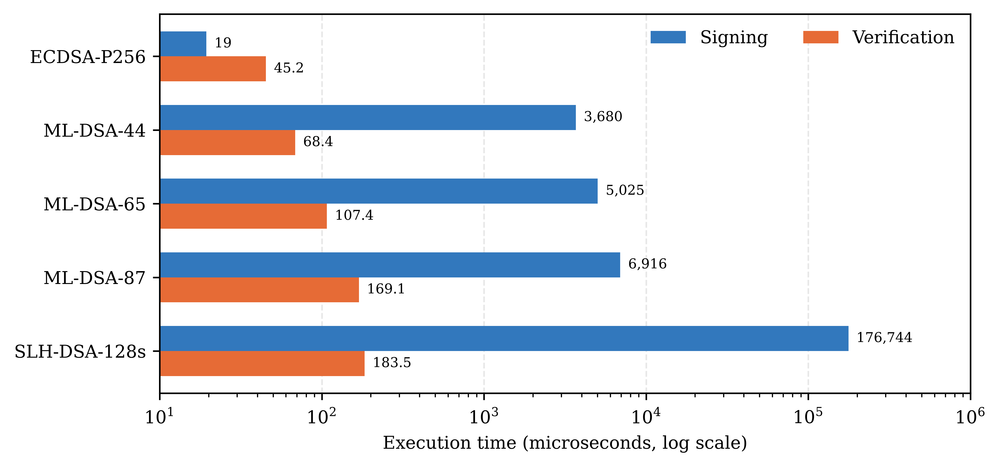
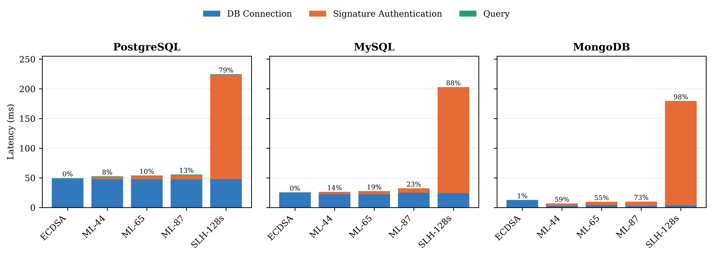
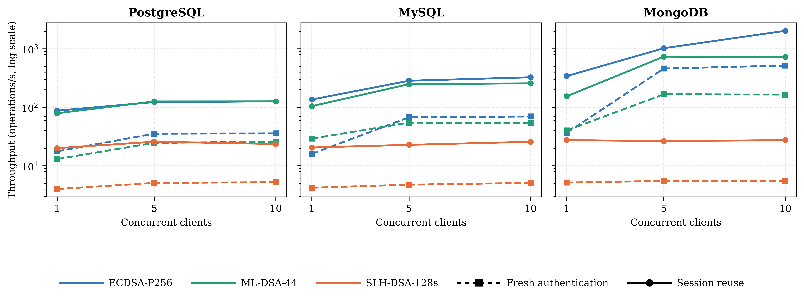
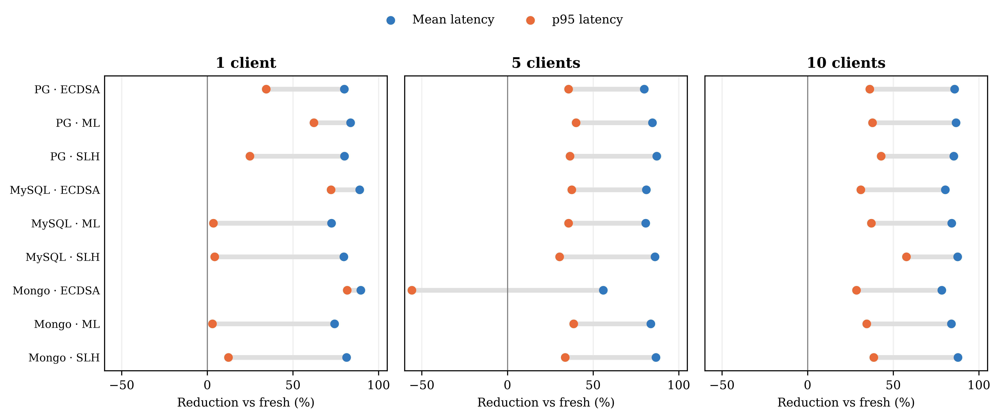
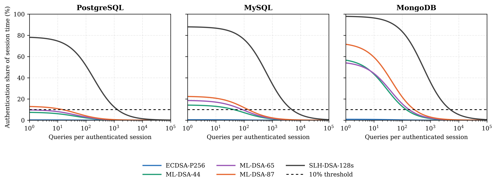

# Post-Quantum Database Authentication Benchmark

**Performance and Scalability of Post-Quantum Authentication in Heterogeneous Database Systems**

This repository presents an experimental evaluation of classical and post-quantum digital signature authentication across heterogeneous database systems. It examines cryptographic performance, database-access overhead, concurrent workloads, and authenticated session reuse.

The study evaluates PostgreSQL, MySQL, and MongoDB using application-layer signature authentication performed before native database access.

## Cryptographic Algorithms

| Algorithm | Type |
|---|---|
| ECDSA-P256 | Classical baseline |
| ML-DSA-44 | Post-quantum, lattice-based |
| ML-DSA-65 | Post-quantum, lattice-based |
| ML-DSA-87 | Post-quantum, lattice-based |
| SLH-DSA-SHA2-128s | Post-quantum, hash-based |

ML-DSA and SLH-DSA are standardized under NIST FIPS 204 and FIPS 205, respectively.

## Research Questions

- **RQ1: Cryptographic Cost.** How do classical and post-quantum signatures compare in key generation, signing, verification, and cryptographic artifact sizes?
- **RQ2: Database-Access Overhead.** How does signature authentication contribute to access latency across PostgreSQL, MySQL, and MongoDB?
- **RQ3: Concurrency and Session Reuse.** How do concurrent workloads and authenticated session reuse affect throughput, mean latency, and tail latency?
- **RQ4: Authentication Cost Amortization.** How many queries per authenticated session are required to reduce authentication overhead to 10% or less and 5% or less?

## Experimental Results

### RQ1: Cryptographic Performance

The first experiment measures key-generation, signing, and verification latency, alongside public-key and signature sizes.



ML-DSA signing is approximately 190 to 357 times slower than ECDSA-P256, while SLH-DSA signing is approximately 9,111 times slower in the evaluated implementation. Verification introduces substantially smaller relative overhead.

### RQ2: Database-Access Overhead

The second experiment decomposes database-access latency into signature authentication, native connection establishment, and query execution.



The relative authentication overhead varies considerably across database systems. PostgreSQL's higher native connection latency reduces the proportional impact of ML-DSA, while MongoDB's shorter connection times make the authentication cost more prominent.

### RQ3: Concurrency and Session Reuse

The third experiment evaluates 1, 5, and 10 concurrent clients under two configurations:

- **Fresh:** Authentication and native connection establishment are repeated for every database operation.
- **Reuse:** Each client authenticates and connects once, then executes five operations using the established connection.

**Throughput under concurrent workloads**



**Mean and p95 latency reduction**



Across the evaluated configurations, authenticated session reuse achieves:

- **4.8x** median throughput improvement.
- **84%** median reduction in mean operation latency.
- **35.7%** median reduction in p95 latency.

These improvements reflect avoiding both repeated cryptographic authentication and repeated native database connection establishment.

### RQ4: Authentication Cost Amortization

The fourth experiment examines how authentication overhead decreases as more queries are executed within an authenticated session.



Using measured authentication, connection, and query latencies, the analysis estimates the minimum session length required to reduce authentication overhead to 10% or less and 5% or less.

The results indicate that ML-DSA can be amortized over relatively short sessions in some database environments, whereas SLH-DSA may require thousands of operations per authenticated session.

## Experimental Environment

| Component | Configuration |
|---|---|
| CPU | Intel Core i7-14700K, 20 cores, 28 threads |
| RAM | 128 GB |
| Operating System | Windows 11 Enterprise, 64-bit |
| Cryptographic Libraries | `cryptography`, `liboqs-python` |
| PostgreSQL | 18.6 |
| MySQL | 8.0.46 |
| MongoDB | 9.0.4 |

Database-access experiments use 100 measured iterations per algorithm/database combination. Concurrency experiments evaluate 1, 5, and 10 clients, with five operations per client.

## Repository Structure

```text
pqc-db-auth-benchmark/
├── Figures/
│   ├── RQ1_Figure.png
│   ├── RQ2_Figure.png
│   ├── RQ3_Figure.png
│   ├── RQ3_Figure_2.png
│   └── RQ4_Figure.png
└── README.md
```

## Scope and Limitations

The experiments evaluate an application-layer signature procedure that precedes native database access. Signature verification is performed locally within the experimental application, without modifying the databases' native authentication protocols.

The results characterize computational and database-access performance rather than the security of a deployed, database-enforced post-quantum authentication protocol.

RQ3 measurements cover low-to-moderate concurrency, and RQ4 session-length thresholds are model-based estimates derived from measured latency components.
